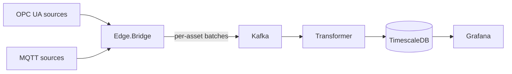

# Telemetrix

**Industrial telemetry, from plant signals to time-series insights.**

[](https://github.com/quenzvezda/Telemetrix/actions/workflows/ci.yml)
[](global.json)
[](ROADMAP.md)

Telemetrix is a C# / .NET 10 project for industrial telemetry ingestion, event streaming, and time-series storage. Its architecture connects OPC UA and MQTT sources to Kafka through an edge bridge, then processes measurements for TimescaleDB and Grafana.

## Project status

The repository contains service scaffolds, Docker Compose infrastructure definitions, database initialization SQL, Grafana provisioning, CI, and a specification-driven roadmap. Pipeline behavior is being implemented incrementally; the services do not yet deliver an end-to-end telemetry flow.

See the [roadmap](ROADMAP.md) for progress and the [design document](docs/plant-telemetry-pipeline.md) for requirements.

## Architecture

The following diagram describes the target pipeline:



Design objectives:

- **Reliable delivery:** durable edge buffering and replay after connectivity failures.
- **Idempotent storage:** bulk writes with conflict handling to prevent duplicate measurement rows.
- **Measurement fidelity:** source timestamps, quality handling, and explicit gap reporting.
- **Operational visibility:** telemetry trends, pipeline health, and measurable latency and throughput.
- **Clear boundaries:** shared contracts with separate ingestion, processing, and storage modules.

Acceptance criteria and failure scenarios are tracked in [OpenSpec changes](openspec/changes/) and [architecture decisions](docs/adr/).

## Technology

| Area | Stack |
| --- | --- |
| Services | C# / .NET 10 Worker Services |
| Industrial connectivity | OPC UA, MQTT |
| Event streaming | Apache Kafka |
| Planned edge buffer | SQLite |
| Time-series storage | PostgreSQL 17 + TimescaleDB |
| Visualization | Grafana |
| Local infrastructure | Docker Compose, Mosquitto, Kafka UI, OPC PLC simulator |
| Verification | GitHub Actions; Testcontainers integration tests planned |

## Getting started

### Prerequisites

- .NET SDK 10.0.300 or a compatible feature band selected by [global.json](global.json).
- Docker with Docker Compose, such as Docker Desktop.
- UaExpert to inspect OPC UA nodes and values.
- Node.js 22+ for the optional OpenSpec CLI.

### Build

```sh
dotnet restore
dotnet build --no-restore -c Release
dotnet test -c Release
```

The test projects are currently scaffolds. Scenario coverage will be added with the corresponding milestones.

### Local infrastructure

From the repository root:

```sh
cp deploy/.env.example deploy/.env
```

In PowerShell, use `Copy-Item deploy/.env.example deploy/.env`. Set `POSTGRES_PASSWORD` in `deploy/.env`, then start the stack:

```sh
docker compose -f deploy/docker-compose.yml up -d
docker compose -f deploy/docker-compose.yml ps
```

This starts the infrastructure services. Bridge and Transformer are not yet included as Compose services. OPC PLC simulation and node mapping are verified as part of the environment and ingestion milestones.

| Service | Local endpoint |
| --- | --- |
| OPC PLC | `opc.tcp://localhost:50000` |
| MQTT / Mosquitto | `localhost:1883` |
| Kafka, host / Compose clients | `localhost:29092` / `kafka:9092` |
| Kafka UI | <http://localhost:8080> |
| TimescaleDB | `localhost:5432`, database and user: `telemetry` |
| Grafana | <http://localhost:3000>, initial login: `admin` / `admin` |

The stack uses local development settings, including unsecured OPC UA and plaintext Kafka listeners. Production security is tracked in the roadmap.

Stop the stack while retaining its data:

```sh
docker compose -f deploy/docker-compose.yml down
```

To reset Kafka and database data, run `docker compose -f deploy/docker-compose.yml down -v`. Database initialization SQL runs only when the database volume is empty.

## Repository guide

| Path | Purpose |
| --- | --- |
| [src/](src/) | Contracts, edge bridge, transformer, and simulator project scaffolds |
| [tests/](tests/) | Unit and integration test project scaffolds |
| [deploy/](deploy/) | Compose stack, database initialization, and Grafana provisioning |
| [Design](docs/plant-telemetry-pipeline.md) | Architecture, data model, and FR/NFR requirements |
| [Domain glossary](CONTEXT.md) | Shared vocabulary for samples, batches, assets, tags, quality, and gaps |
| [Architecture decisions](docs/adr/) | Decision records and tradeoffs |
| [Roadmap](ROADMAP.md) | Milestones, acceptance criteria, and open decisions |
| [OpenSpec](openspec/) | Change proposals, specifications, and implementation checklists |

## Development workflow

Each milestone maps to one OpenSpec change. Tasks include verification criteria, and completed changes are archived into accepted specifications. Package versions are managed centrally, nullable reference types are enabled, and build warnings are treated as errors.

```sh
npx -y @fission-ai/openspec@1.14.3 list
npx -y @fission-ai/openspec@1.14.3 show add-local-environment
```

OpenSpec workflows for Claude Code live in `.claude/`; Codex adapters live in `.agents/skills/`. Both use the same workflow instructions and project review checkpoints.
