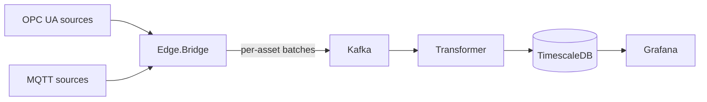

# Telemetrix

**Industrial telemetry, from plant signals to time-series insights.**

[](https://github.com/quenzvezda/Telemetrix/actions/workflows/ci.yml)
[](global.json)
[](ROADMAP.md)

Telemetrix is a C# / .NET 10 project for industrial telemetry ingestion, event streaming, and time-series storage. Its architecture connects OPC UA and MQTT sources to Kafka through an edge bridge, then processes measurements for TimescaleDB and Grafana.

## Project status

M1–M8 are accepted and archived; see the [accepted specifications](openspec/specs/) and [M8 review](docs/m8-review.md). PlantSim and MqttSim share the seven-tag pumping-line model; Bridge selects OPC UA or MQTT by configuration. M8 adds health endpoints, correlated JSON logs, OpenTelemetry metrics, SQL rollups/retention, a Grafana dashboard and measured load profiles. The reviewer deferred two M8 manual checks until M9 is complete; they remain unverified and are tracked in the [M9 checklist](openspec/changes/add-opcua-security/tasks.md). The clean topic is deferred to the separate sink (ADR-0012).

See the [roadmap](ROADMAP.md) for progress and the [design document](docs/plant-telemetry-pipeline.md) for requirements.

## Architecture

The following diagram describes the target pipeline:



Design objectives:

- **Reliable delivery:** durable edge buffering and replay after connectivity failures.
- **Idempotent storage:** bulk writes with conflict handling to prevent duplicate measurement rows.
- **Measurement fidelity:** source timestamps, quality handling, and explicit gap reporting.
- **Operational visibility:** telemetry trends, pipeline health, and measurable latency and throughput.
- **Clear boundaries:** shared contracts with separate ingestion, processing, and storage modules.

Acceptance criteria and failure scenarios are tracked in [OpenSpec](openspec/) and [architecture decisions](docs/adr/).

## Technology

| Area | Stack |
| --- | --- |
| Services | C# / .NET 10 hosted workers with slim HTTP hosts |
| Industrial connectivity | OPC UA, MQTT |
| Event streaming | Apache Kafka |
| Edge buffer | SQLite |
| Time-series storage | PostgreSQL 17 + TimescaleDB |
| Visualization | Grafana |
| Local infrastructure | Docker Compose, Mosquitto, Kafka UI, OPC PLC and PlantSim simulators |
| Verification | GitHub Actions; pure unit tests and Testcontainers OPC UA, Kafka and TimescaleDB tests |

## Getting started

### Prerequisites

- .NET SDK 10.0.300 or a compatible feature band selected by [global.json](global.json).
- Docker with Docker Compose, such as Docker Desktop.
- UaExpert to inspect OPC UA nodes and values.
- Node.js 22+ for the optional OpenSpec CLI.

### Build

```sh
dotnet restore
dotnet build --no-restore -c Release
dotnet test -c Release
```

The suite covers contracts, batching, buffer quota/FIFO/restart, source and capacity gaps, quality and tag resolution, plus OPC UA recovery, Kafka publishing/group assignment/DLQ and transactional TimescaleDB storage. Docker must be running for integration tests, which create disposable infrastructure with generated connection settings. They do not use the local Compose database or its password.

### Local environment

Default Compose runs PlantSim, OPC PLC, Mosquitto, Kafka, Kafka UI, TimescaleDB and Grafana. Run Bridge and Transformer on the host, or select the `pipeline` profile for their containers. The `metrics` profile adds the pipeline and Prometheus; `mqtt` adds MqttSim. The separate `migrations` profile provides an explicitly invoked SQL runner.

#### Start the stack

Run all commands from the repository root. On a fresh clone, create the local environment file in PowerShell:

```powershell
Copy-Item deploy/.env.example deploy/.env
```

On a POSIX shell, use `cp deploy/.env.example deploy/.env` instead. Open `deploy/.env` and replace `change-me` with a local password for `POSTGRES_PASSWORD`. Keep an existing `.env` when resuming work; it is ignored by Git and must not be committed.

Validate the configuration without printing its resolved secrets, then start the stack:

```powershell
docker compose -f deploy/docker-compose.yml config --quiet
docker compose -f deploy/docker-compose.yml up -d
docker compose -f deploy/docker-compose.yml ps -a
```

Expected: all seven services are `Up`, and `kafka` and `timescaledb` become `healthy`. The first start builds PlantSim, downloads the pinned infrastructure images and initializes an empty database volume. If `POSTGRES_PASSWORD` is missing or empty, Compose stops with an error naming that variable. If a service exits or remains unhealthy, inspect its logs with `docker compose -f deploy/docker-compose.yml logs --tail 100 <service>`.

#### Endpoints and accounts

| Service | From the host | From another Compose service | Account / notes |
| --- | --- | --- | --- |
| OPC PLC | `opc.tcp://localhost:50000` | `opc.tcp://opc-plc:50000` | SignAndEncrypt, explicit certificate trust, Anonymous |
| PlantSim | `opc.tcp://localhost:4840` | `opc.tcp://plantsim:4840` | SignAndEncrypt, explicit certificate trust, Anonymous; [tags and fault methods](src/Telemetrix.PlantSim/README.md) |
| MQTT / Mosquitto | `localhost:1883` | `mosquitto:1883` | Anonymous |
| Kafka | `localhost:29092` | `kafka:9092` | Create topics explicitly |
| Kafka UI | <http://localhost:8080> | `http://kafka-ui:8080` | Cluster `local` |
| TimescaleDB | `localhost:5432` | `timescaledb:5432` | Database and user `telemetry`; password from `deploy/.env` |
| Grafana | <http://localhost:3000> | `http://grafana:3000` | Initial login `admin` / `admin`; dashboard `/d/telemetrix` after migration |
| Bridge HTTP | <http://localhost:5101/health> | `http://bridge:5101/health` | `pipeline` or `metrics` profile; `/metrics` when enabled |
| Transformer HTTP | <http://localhost:5102/health> | `http://transformer:5102/health` | `pipeline` or `metrics` profile; `/metrics` when enabled |
| PlantSim HTTP | <http://localhost:5103/health> | `http://plantsim:5103/health` | Server/simulation readiness |
| MqttSim HTTP | <http://localhost:5104/health> | `http://mqttsim:5104/health` | `mqtt` profile; broker/publication readiness |
| Prometheus | <http://localhost:9090> | `http://prometheus:9090` | `metrics` profile |

Compose uses secured OPC UA with persistent certificates. Kafka, Postgres and MQTT transport security remain outside M9's scope.

#### OPC UA security and explicit trust (M9)

Start the secure pipeline (the `pipeline` and `metrics` profiles use the same secure OPC UA settings):

```powershell
docker compose -f deploy/docker-compose.yml --profile secure up -d --build
./deploy/Trust-OpcUaCertificates.ps1
```

Initially the Bridge cannot establish a session. PlantSim rejects the untrusted
Bridge certificate, logging its subject and thumbprint. The helper above only
displays both public identities; it grants no trust. Compare the thumbprints with
the applications' certificates/logs, then explicitly approve those identities:

```powershell
./deploy/Trust-OpcUaCertificates.ps1 -BridgeThumbprint '<observed bridge thumbprint>' -ServerThumbprint '<observed plantsim thumbprint>'
docker compose -f deploy/docker-compose.yml logs --since 1m bridge
```

Expected: `OPC UA session established with SignAndEncrypt` and policy
`http://opcfoundation.org/UA/SecurityPolicy#Basic256Sha256`, followed by samples
and batches. Neither service is restarted. A mismatched thumbprint stops the
helper before either trust list is changed. It copies only public `.der` files;
private keys remain in `own/private` in persistent PKI volumes.

Alternatively inspect `/app/pki/rejected/certs` inside the rejecting container,
then move only the peer certificate you verified into
`/app/pki/trusted/certs`. With both peers initially untrusted, the server can
reject the client before the client sees the server certificate: grant the first
direction of trust, allow a retry, then inspect and trust the other peer.
The helper bootstraps this exchange from both `own/certs` stores instead.
Repeat with `-Server opc-plc` when using OPC PLC; configure the Bridge endpoint
and OPC PLC tag mapping separately. Secure endpoint selection matches mode and
policy exactly and never falls back to None.

Bridge settings: `OpcUa:Security:Mode` (`None`, `Sign`, `SignAndEncrypt`),
`Policy` (`Basic256Sha256`), `PkiRoot` (default `pki`), and
`AutoAcceptUntrusted` (default `false`). Environment variables use double
underscores, e.g. `OpcUa__Security__PkiRoot`. The former
`OpcUa:SecurityMode` setting has been replaced. None and auto-accept are refused
outside **Development**, including the named **PlantSim** environment.
The Development launch profile explicitly selects None and logs an insecure
connection warning. To connect a host Bridge to the secure Compose OPC PLC,
override `--OpcUa:Security:Mode=SignAndEncrypt` and manually exchange its public
certificate with OPC PLC. Host PKI stores are relative to the working directory;
each application/instance must use its own root. PlantSim uses
`PlantSim:PkiPath` (default `pki/plantsim`) and `PlantSim:SecurityMode`.

PlantSim certificates include `localhost` and `plantsim` SANs. Compose fixes
application hostnames and keeps certificates in named volumes across recreation.
M9 provisions a new `plantsim-secure-pki` volume, preserving the old M8 PKI.
When rotating certificates, review and replace the peer's trusted public
certificate explicitly. Check host/container clocks if validity checks fail;
never bypass certificate validation to resolve a clock or hostname mismatch.

Acceptance commands and outstanding manual checks are in [M9 review](docs/m9-review.md).

#### Run the OPC UA Bridge

With OPC PLC and Kafka running, launch the Bridge from the repository root:

```powershell
dotnet run --project src/Telemetrix.Edge.Bridge -- --OpcUa:Security:Mode=SignAndEncrypt
```

The Development launch profile maps seven domain tags to the OPC PLC nodes verified in M1. The Bridge creates its owned topics if absent, then logs accepted batches with asset and sample count. An accepted batch has either been acknowledged by Kafka or persisted in the edge buffer. Samples retain UTC source/server timestamps and raw status codes. To exercise recovery, keep the Bridge running and restart OPC PLC from another terminal:

```powershell
docker compose -f deploy/docker-compose.yml restart opc-plc
```

Samples resume after the session is restored. Stop the Bridge with Ctrl+C. To discover all variables under OPC PLC's telemetry folder using server browse names, run:

```powershell
dotnet run --project src/Telemetrix.Edge.Bridge -- --OpcUa:Security:Mode=SignAndEncrypt --OpcUa:BrowseStartNode=Objects/OpcPlc/Telemetry
```

See the [accepted OPC UA spec](openspec/specs/opcua-ingestion/spec.md) and [M2 recovery review](docs/m2-group3-review.md) for behavior and verification details.

#### Edge buffer settings

The default SQLite file is `LocalApplicationData/Telemetrix/buffer/bridge.db`
(`%LOCALAPPDATA%\Telemetrix\buffer\bridge.db` on Windows). Override
`Buffer:Path` / `Buffer__Path` with an absolute path in a persistent writable
directory; each Bridge instance must own a different file. Preserve the file
across restarts and container replacements. `*.db`, WAL and shared-memory files
are ignored by Git.

`Buffer:MaxBytes` / `Buffer__MaxBytes` defaults to `67108864` (64 MiB of serialized
payloads). The sizing test covers an hour of the default seven tags with a
notification every 500 ms and leaves more than half the quota free. Retention
does not expire by age. Provision extra space for SQLite pages, indexes and WAL;
this setting is a payload quota, not a filesystem quota.

At 80% usage collection pauses; at 50% it can resume. Already buffered batches
are retained and replay continues. Source changes while paused are unavailable;
plant events report the gap with reason `buffer-capacity` (ADR-0013).
An entry larger than the entire quota fails configuration at runtime rather than
being discarded. Do not lower the quota below the size of a serialized batch.

Kafka delivery failures switch to buffering. Incoming batches join the FIFO until
it is empty, and replay deletes an entry only after acknowledgement. Ambiguous
acknowledgements can cause replay; Transformer storage remains duplicate-safe.
Graceful stop persists accepted input; an abrupt kill before a pending delivery
has spilled to disk still has an in-memory loss window.

The Bridge logs buffering start, empty, and capacity transitions. Meter
`Telemetrix.Edge.Bridge` exposes `bridge.buffer.batches` (queued entries, including
plant events) and `bridge.buffer.samples`. The M8 `Telemetrix.Bridge` meter also
exports `telemetrix.buffer.depth`, received samples and acknowledged batches.

`plant.events` has three partitions and 30-day retention. Messages are keyed by
asset and use the shared `PlantEvent` contract with `ConnectionLost`,
`ConnectionRestored` or `Gap`. Gap bounds are the last collected and first resumed
source timestamps; collection never invents values for the missing interval.
OPC UA recovery handles server restarts, and initial server unavailability is
retried without exiting. Inspect events in
[Kafka UI](http://localhost:8080/ui/clusters/local/all-topics/plant.events/messages).

To repeat the deterministic 30-minute Kafka outage check with Docker running:

```powershell
./scripts/Test-M5EdgeOutage.ps1
```

This uses the real Bridge pipeline and a deterministic seven-tag source at one
sample per tag per second with the default 500-sample / five-second batching.
It stops Kafka for at least 1,800 measured seconds, drains SQLite after recovery,
and checks all seven tag counts and zero Transformer lag in a fresh TimescaleDB.
Expected final verification: `M5_PASS: sent=12880, stored=12880, tags=7, lag=0`.
The source includes 40 seconds beyond the outage for startup/recovery observation.
Every invocation creates and removes only its uniquely named disposable project,
database/buffer volumes and locally built review images. It uses no normal local
database or `deploy/.env` credentials. A short harness check is available with
`-OutageSeconds 15` (385 samples); CI runs this short check alongside the full
integration suite. The short check does not replace the 30-minute NFR-02 test.

#### Observability and dashboard

Every application serves `/health`; configure `Http:Port` (`Http__Port`) to
change its listener. Healthy/Degraded returns 200, failed critical dependencies
return 503 with named checks. JSON console logs carry UTC timestamps and scoped
`batchId`/`assetId` properties through Bridge and Transformer.

Enable the optional pipeline/Prometheus containers:

```powershell
docker compose -f deploy/docker-compose.yml --profile metrics up -d --build
```

Do not run host and container instances on the same HTTP ports or against the
same SQLite buffer. Prometheus at <http://localhost:9090> scrapes the pipeline
every five seconds. Query `telemetrix_samples_received_total`,
`telemetrix_rows_written_total`, `telemetrix_buffer_depth` and
`telemetrix_consumer_lag`. `/metrics` is enabled by
`Telemetry__Prometheus__Enabled=true`; the console exporter can be selected with
`Telemetry__Console__Enabled=true`. The pipeline profile uses PlantSim by default.

Review the SQL under `deploy/sql/migrations/` before applying it. Then explicitly
run `docker compose -f deploy/docker-compose.yml --profile migrations run --rm db-migrate`.
Default stack startup does not apply migrations. The scripts add one-minute
Good-only rollups, 30-day raw and one-year rollup retention, and stored plant
events; they also backfill retained historical measurements.
Set `PLANT_EVENTS_ENABLED=true` in `deploy/.env` only after migration, then restart
Transformer with the selected profile. Open <http://localhost:3000/d/telemetrix>
for asset/tag trends, pump state and gaps. Six-hour ranges and longer use rollups;
shorter ranges use raw Good measurements. Refresh is ten seconds.

The [M8 review package](docs/m8-review.md) supplies exact checks, SQL and expected
results. [Load profiles](docs/load-test.md) record hardware, source settings,
latency and throughput evidence. Long load tests run explicitly through
`deploy/Test-M8Load.ps1`; ordinary CI runs their smaller regression tests.

#### Run the Transformer

Start Bridge first so that its raw topic exists. Configure `ConnectionStrings:Telemetry`
through environment variable `ConnectionStrings__Telemetry` or another .NET configuration
provider; keep credentials out of committed files. In a dedicated PowerShell terminal,
enter the database password without putting it in command history:

```powershell
$dbPassword = Read-Host 'POSTGRES_PASSWORD from deploy/.env' -AsSecureString
$quotedPassword = ([System.Net.NetworkCredential]::new('', $dbPassword).Password).Replace('"', '""')
$env:ConnectionStrings__Telemetry = 'Host=localhost;Port=5432;Database=telemetry;Username=telemetry;Password="' + $quotedPassword + '"'
Remove-Variable dbPassword, quotedPassword
try {
    dotnet run --project src/Telemetrix.Transformer -c Release
} finally {
    Remove-Item Env:ConnectionStrings__Telemetry
}
```

Expect DLQ initialization, catalog loading, partition assignment in group `transformer`
and `Stored batch` / `Processed batch` logs. Inspect live rows using the SQL in the
[M3 storage review](docs/m3-group5-review.md). A new consumer group reads retained
raw batches from the earliest offset. Stop with Ctrl+C.

Unknown tags go to `plant.telemetry.dlq` by default. Explicit
`--TagResolution:UnknownTagPolicy=create` creates tags for existing assets without
unit or range. Automatic offset commit and storage are disabled. Transformer commits
only after database storage and any required DLQ acknowledgement succeed; storage
failures are retried with backoff until success or shutdown. Invalid envelopes go
to DLQ with their original key/payload and error/origin headers before committing.
Kafka replay is safe because `(tag_id, time)` is unique (ADR-0003).

#### Verify Transformer crash recovery

With Docker running, execute the bounded, deterministic M4 check:

```powershell
./scripts/Test-M4Delivery.ps1
```

It kills the production Transformer container while a source is publishing 20,000
distinct samples, restarts it, then checks all batch counts and zero Kafka lag.
The script creates a uniquely named disposable Compose project and cleans up only
that project's containers, network, images and database volume. It uses no normal
local stack volumes, host ports or credentials. See the [M4 review](docs/m4-review.md)
for evidence and expected output. The same check runs in CI; the one-hour NFR-01
observation and M5 Kafka-outage buffering are separate checks.

#### Browse OPC UA with UaExpert

Install [UaExpert](https://www.unified-automation.com/downloads/opc-ua-clients/uaexpert.html) on the host. On first launch, create its application certificate; `Telemetrix` can be used for the required Organization field, with the other defaults retained.

1. Choose **Server > Add**, add `opc.tcp://localhost:50000` under **Custom Discovery**, and expand the OPC PLC server to see its endpoints.
2. If **Replace Hostname** appears, choose **Yes** to use `localhost` instead of the container hostname returned by discovery.
3. Select policy **Basic256Sha256** and mode **SignAndEncrypt**, keep **Anonymous**, and confirm with **OK**. Explicitly trust UaExpert's public certificate in OPC PLC's `/app/pki/trusted/certs` before retrying.
4. Select the server and choose **Server > Connect**. For the local OPC PLC certificate, use **Trust Server Certificate**, or accept it temporarily for the session, then continue.
5. Expand **Objects > OpcPlc > Telemetry** in Address Space and drag variables such as `FastUInt1` and `AlternatingBoolean` into Data Access View.
6. Verify that values change and that source timestamps, data types and status codes are visible. Nodes intended to simulate poor quality can show non-Good status codes.

The [M1 node inventory](docs/m1-opcua-verification.md) records the observed NodeIds and data types for M2 mapping. Namespace index `3` was observed in this server; check the namespace table when configuring a client. If a container is recreated, its hostname and certificate can change, so repeat discovery or certificate acceptance as needed.

#### Inspect Kafka

Open [Kafka UI](http://localhost:8080), select **local > Topics**, and create `scratch.test` with one partition and replication factor one. Produce `{"message":"hello telemetrix"}`, verify it on the **Messages** tab, then delete the test topic.

Topic auto-creation is disabled. Sending to an uncreated topic must fail; see the [group 2 review commands](docs/m1-group2-review.md#23-missing-kafka-topic) for the bounded console-producer check.

#### Inspect TimescaleDB

Use `psql` inside the container; no host PostgreSQL client is required:

```powershell
docker compose -f deploy/docker-compose.yml exec -T timescaledb psql -X -v ON_ERROR_STOP=1 -U telemetry -d telemetry -c "SELECT count(*) FROM tag"
docker compose -f deploy/docker-compose.yml exec -T timescaledb psql -X -v ON_ERROR_STOP=1 -U telemetry -d telemetry -c "SELECT hypertable_schema, hypertable_name FROM timescaledb_information.hypertables"
```

Expected: the first query returns `7` for the seed catalog (more if tags were explicitly created), and the second includes `public | measurement`. The initialization script seeds two assets and seven tags. Running Bridge and Transformer adds live measurements.

#### Test Grafana's database connection

Sign in at <http://localhost:3000> with `admin` / `admin` on first start, then set a new Grafana password when prompted. On later visits, use the password you set.

Open **Connections > Data sources > TimescaleDB**, scroll to the bottom and click **Test**. Expected: **Database Connection OK**. The provisioned data source already contains its database settings; creating another connection is unnecessary.

The Grafana login is separate from the PostgreSQL account. `POSTGRES_PASSWORD` supplied to Grafana is used by the data source to connect as database user `telemetry`; it does not set the Grafana administrator password.

#### Test MQTT

M7's [MqttSim](src/Telemetrix.MqttSim/README.md) publishes the same seven pumping-line
tags as PlantSim, using their shared simulation model. With Mosquitto running:

```powershell
dotnet run --project src/Telemetrix.MqttSim -c Release
```

Use a unique `--MqttSim:ClientId` if running more than one simulator. The simulator
README lists all settings and the Docker alternative.

Select MQTT in a dedicated Bridge terminal (Transformer keeps its existing configuration):

```powershell
dotnet run --project src/Telemetrix.Edge.Bridge -c Release -- --Source:Kind=Mqtt
```

`Source__Kind=Mqtt` is the equivalent environment setting. `Source:Mqtt:Host`,
`Port`, `TopicFilter` and `ClientId` default to `localhost`, `1883`,
`plant/+/+/+/+` and `telemetrix-bridge`. Every concurrent Bridge needs a unique
client id. MQTT startup does not require OPC UA tag configuration. The optional
`Mqtt` environment loads `appsettings.Mqtt.json`; the default source remains OPC UA.
MQTT payload booleans become numeric 1/0 before batching. See
[ADR-0014](docs/adr/0014-mqtt-payload-and-session-boundaries.md) for session and
capacity-pause behavior.

In terminal A, start a subscriber that exits after one message or 30 seconds:

```powershell
docker compose -f deploy/docker-compose.yml exec -T mosquitto mosquitto_sub -h localhost -t telemetrix/m1/smoke -C 1 -W 30 -v -d
```

When terminal A reports `SUBACK`, publish from terminal B:

```powershell
docker compose -f deploy/docker-compose.yml exec -T mosquitto mosquitto_pub -h localhost -t telemetrix/m1/smoke -m hello
```

Expected in terminal A: `telemetrix/m1/smoke hello`. The publisher succeeds without output. These commands use the MQTT tools bundled in the Mosquitto container.

#### Stop, resume and reset

For a normal pause, keep the containers and their current state:

```powershell
docker compose -f deploy/docker-compose.yml stop
docker compose -f deploy/docker-compose.yml start
```

`docker compose -f deploy/docker-compose.yml down` removes containers and the network while keeping the named Kafka, database, buffer and OPC UA PKI volumes. Grafana's local accounts are not backed by a named volume; use `stop` / `start` to keep its current container.

To deliberately reset the local environment, remove the containers **and Kafka/database data**, then start again:

```powershell
docker compose -f deploy/docker-compose.yml down -v
docker compose -f deploy/docker-compose.yml up -d
docker compose -f deploy/docker-compose.yml ps -a
```

`deploy/.env` stays in place. `deploy/sql/init.sql` runs only when the database volume is empty, so this reset recreates the schema and seed tags. Reconnect UaExpert and repeat the inspection steps after a reset. Detailed checks and recorded results are available in the [M1 group 2 review package](docs/m1-group2-review.md).

## Repository guide

| Path | Purpose |
| --- | --- |
| [src/](src/) | Shared contracts, OPC UA Bridge, Transformer pipeline/storage, and simulator scaffolds |
| [tests/](tests/) | Bridge/Transformer unit tests and disposable infrastructure integration tests |
| [tools/Telemetrix.DeliveryProbe/](tools/Telemetrix.DeliveryProbe/) | Deterministic test source and read-only verifier for the M4 container crash check |
| [scripts/Test-M4Delivery.ps1](scripts/Test-M4Delivery.ps1) | Isolated kill-under-load review harness |
| [deploy/](deploy/) | Compose stack, database initialization, and Grafana provisioning |
| [Design](docs/plant-telemetry-pipeline.md) | Architecture, data model, and FR/NFR requirements |
| [Domain glossary](CONTEXT.md) | Shared vocabulary for samples, batches, assets, tags, quality, and gaps |
| [Architecture decisions](docs/adr/) | Decision records and tradeoffs |
| [Roadmap](ROADMAP.md) | Milestones, acceptance criteria, and open decisions |
| [OpenSpec](openspec/) | Change proposals, specifications, and implementation checklists |

## Development workflow

Each milestone maps to one OpenSpec change. Tasks include verification criteria, and completed changes are archived into accepted specifications. Package versions are managed centrally, nullable reference types are enabled, and build warnings are treated as errors.

```sh
npx -y @fission-ai/openspec@1.14.3 list
npx -y @fission-ai/openspec@1.14.3 show local-environment --type spec
```

OpenSpec workflows for Claude Code live in `.claude/`; Codex adapters live in `.agents/skills/`. Both use the same workflow instructions and project review checkpoints.
