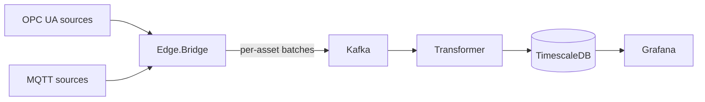

# Telemetrix

**Industrial telemetry, from plant signals to time-series insights.**

[](https://github.com/quenzvezda/Telemetrix/actions/workflows/ci.yml)
[](global.json)
[](ROADMAP.md)

Telemetrix is a C# / .NET 10 project for industrial telemetry ingestion, event streaming, and time-series storage. Its architecture connects OPC UA and MQTT sources to Kafka through an edge bridge, then processes measurements for TimescaleDB and Grafana.

## Project status

M1's local environment, M2's OPC UA client and M3's first end-to-end slice are complete, manually verified and archived; see the [M3 final review](docs/m3-group6-review.md) and [accepted specifications](openspec/specs/). M4 delivery guarantees are implemented and in final review: Transformer commits offsets after durable processing, retries storage failures and dead-letters invalid batches. Replay, rebalance and crash checks are recorded in the [M4 review package](docs/m4-review.md). Durable edge buffering follows in M5; the clean topic is deferred to the separate sink (ADR-0012).

See the [roadmap](ROADMAP.md) for progress and the [design document](docs/plant-telemetry-pipeline.md) for requirements.

## Architecture

The following diagram describes the target pipeline:



Design objectives:

- **Reliable delivery:** durable edge buffering and replay after connectivity failures.
- **Idempotent storage:** bulk writes with conflict handling to prevent duplicate measurement rows.
- **Measurement fidelity:** source timestamps, quality handling, and explicit gap reporting.
- **Operational visibility:** telemetry trends, pipeline health, and measurable latency and throughput.
- **Clear boundaries:** shared contracts with separate ingestion, processing, and storage modules.

Acceptance criteria and failure scenarios are tracked in [OpenSpec](openspec/) and [architecture decisions](docs/adr/).

## Technology

| Area | Stack |
| --- | --- |
| Services | C# / .NET 10 Worker Services |
| Industrial connectivity | OPC UA, MQTT |
| Event streaming | Apache Kafka |
| Planned edge buffer | SQLite |
| Time-series storage | PostgreSQL 17 + TimescaleDB |
| Visualization | Grafana |
| Local infrastructure | Docker Compose, Mosquitto, Kafka UI, OPC PLC simulator |
| Verification | GitHub Actions; pure unit tests and Testcontainers OPC UA, Kafka and TimescaleDB tests |

## Getting started

### Prerequisites

- .NET SDK 10.0.300 or a compatible feature band selected by [global.json](global.json).
- Docker with Docker Compose, such as Docker Desktop.
- UaExpert to inspect OPC UA nodes and values.
- Node.js 22+ for the optional OpenSpec CLI.

### Build

```sh
dotnet restore
dotnet build --no-restore -c Release
dotnet test -c Release
```

The suite covers contracts, batching, quality and tag resolution, plus OPC UA recovery, Kafka publishing/group assignment/DLQ and transactional TimescaleDB storage. Docker must be running for integration tests, which create disposable infrastructure with generated connection settings. They do not use the local Compose database or its password.

### Local environment

Compose runs six infrastructure services: OPC PLC, Mosquitto, Kafka, Kafka UI, TimescaleDB and Grafana. Run Bridge and Transformer on the host with the .NET SDK; they are not included as Compose services.

#### Start the stack

Run all commands from the repository root. On a fresh clone, create the local environment file in PowerShell:

```powershell
Copy-Item deploy/.env.example deploy/.env
```

On a POSIX shell, use `cp deploy/.env.example deploy/.env` instead. Open `deploy/.env` and replace `change-me` with a local password for `POSTGRES_PASSWORD`. Keep an existing `.env` when resuming work; it is ignored by Git and must not be committed.

Validate the configuration without printing its resolved secrets, then start the stack:

```powershell
docker compose -f deploy/docker-compose.yml config --quiet
docker compose -f deploy/docker-compose.yml up -d
docker compose -f deploy/docker-compose.yml ps -a
```

Expected: all six services are `Up`, and `kafka` and `timescaledb` become `healthy`. The first start downloads the pinned images and initializes an empty database volume. If `POSTGRES_PASSWORD` is missing or empty, Compose stops with an error naming that variable. If a service exits or remains unhealthy, inspect its logs with `docker compose -f deploy/docker-compose.yml logs --tail 100 <service>`.

#### Endpoints and accounts

| Service | From the host | From another Compose service | Account / notes |
| --- | --- | --- | --- |
| OPC PLC | `opc.tcp://localhost:50000` | `opc.tcp://opc-plc:50000` | Security None, Anonymous |
| MQTT / Mosquitto | `localhost:1883` | `mosquitto:1883` | Anonymous |
| Kafka | `localhost:29092` | `kafka:9092` | Create topics explicitly |
| Kafka UI | <http://localhost:8080> | `http://kafka-ui:8080` | Cluster `local` |
| TimescaleDB | `localhost:5432` | `timescaledb:5432` | Database and user `telemetry`; password from `deploy/.env` |
| Grafana | <http://localhost:3000> | `http://grafana:3000` | Initial login `admin` / `admin` |

The stack uses local development settings, including unsecured OPC UA and plaintext Kafka listeners. Production security is tracked in M9.

#### Run the OPC UA Bridge

With OPC PLC and Kafka running, launch the Bridge from the repository root:

```powershell
dotnet run --project src/Telemetrix.Edge.Bridge
```

The Development launch profile maps seven domain tags to the OPC PLC nodes verified in M1. The Bridge creates `plant.telemetry.raw` if absent (six partitions, seven-day retention), then logs published batches with asset, sample count, partition and offset. Samples retain UTC source/server timestamps and raw status codes. To exercise recovery, keep the Bridge running and restart OPC PLC from another terminal:

```powershell
docker compose -f deploy/docker-compose.yml restart opc-plc
```

Samples resume after the session is restored. Stop the Bridge with Ctrl+C. To discover all variables under OPC PLC's telemetry folder using server browse names, run:

```powershell
dotnet run --project src/Telemetrix.Edge.Bridge -- --OpcUa:BrowseStartNode=Objects/OpcPlc/Telemetry
```

See the [accepted OPC UA spec](openspec/specs/opcua-ingestion/spec.md) and [M2 recovery review](docs/m2-group3-review.md) for behavior and verification details.

#### Run the Transformer

Start Bridge first so that its raw topic exists. Configure `ConnectionStrings:Telemetry`
through environment variable `ConnectionStrings__Telemetry` or another .NET configuration
provider; keep credentials out of committed files. In a dedicated PowerShell terminal,
enter the database password without putting it in command history:

```powershell
$dbPassword = Read-Host 'POSTGRES_PASSWORD from deploy/.env' -AsSecureString
$quotedPassword = ([System.Net.NetworkCredential]::new('', $dbPassword).Password).Replace('"', '""')
$env:ConnectionStrings__Telemetry = 'Host=localhost;Port=5432;Database=telemetry;Username=telemetry;Password="' + $quotedPassword + '"'
Remove-Variable dbPassword, quotedPassword
try {
    dotnet run --project src/Telemetrix.Transformer -c Release
} finally {
    Remove-Item Env:ConnectionStrings__Telemetry
}
```

Expect DLQ initialization, catalog loading, partition assignment in group `transformer`
and `Stored batch` / `Processed batch` logs. Inspect live rows using the SQL in the
[M3 storage review](docs/m3-group5-review.md). A new consumer group reads retained
raw batches from the earliest offset. Stop with Ctrl+C.

Unknown tags go to `plant.telemetry.dlq` by default. Explicit
`--TagResolution:UnknownTagPolicy=create` creates tags for existing assets without
unit or range. Automatic offset commit and storage are disabled. Transformer commits
only after database storage and any required DLQ acknowledgement succeed; storage
failures are retried with backoff until success or shutdown. Invalid envelopes go
to DLQ with their original key/payload and error/origin headers before committing.
Kafka replay is safe because `(tag_id, time)` is unique (ADR-0003).

#### Verify Transformer crash recovery

With Docker running, execute the bounded, deterministic M4 check:

```powershell
./scripts/Test-M4Delivery.ps1
```

It kills the production Transformer container while a source is publishing 20,000
distinct samples, restarts it, then checks all batch counts and zero Kafka lag.
The script creates a uniquely named disposable Compose project and cleans up only
that project's containers, network, images and database volume. It uses no normal
local stack volumes, host ports or credentials. See the [M4 review](docs/m4-review.md)
for evidence and expected output. The same check runs in CI; the one-hour NFR-01
observation and M5 Kafka-outage buffering are separate checks.

#### Browse OPC UA with UaExpert

Install [UaExpert](https://www.unified-automation.com/downloads/opc-ua-clients/uaexpert.html) on the host. On first launch, create its application certificate; `Telemetrix` can be used for the required Organization field, with the other defaults retained.

1. Choose **Server > Add**, add `opc.tcp://localhost:50000` under **Custom Discovery**, and expand the OPC PLC server to see its endpoints.
2. If **Replace Hostname** appears, choose **Yes** to use `localhost` instead of the container hostname returned by discovery.
3. Select an endpoint with security policy **None** and security mode **None**, keep **Anonymous**, and confirm with **OK**.
4. Select the server and choose **Server > Connect**. For the local OPC PLC certificate, use **Trust Server Certificate**, or accept it temporarily for the session, then continue.
5. Expand **Objects > OpcPlc > Telemetry** in Address Space and drag variables such as `FastUInt1` and `AlternatingBoolean` into Data Access View.
6. Verify that values change and that source timestamps, data types and status codes are visible. Nodes intended to simulate poor quality can show non-Good status codes.

The [M1 node inventory](docs/m1-opcua-verification.md) records the observed NodeIds and data types for M2 mapping. Namespace index `3` was observed in this server; check the namespace table when configuring a client. If a container is recreated, its hostname and certificate can change, so repeat discovery or certificate acceptance as needed.

#### Inspect Kafka

Open [Kafka UI](http://localhost:8080), select **local > Topics**, and create `scratch.test` with one partition and replication factor one. Produce `{"message":"hello telemetrix"}`, verify it on the **Messages** tab, then delete the test topic.

Topic auto-creation is disabled. Sending to an uncreated topic must fail; see the [group 2 review commands](docs/m1-group2-review.md#23-missing-kafka-topic) for the bounded console-producer check.

#### Inspect TimescaleDB

Use `psql` inside the container; no host PostgreSQL client is required:

```powershell
docker compose -f deploy/docker-compose.yml exec -T timescaledb psql -X -v ON_ERROR_STOP=1 -U telemetry -d telemetry -c "SELECT count(*) FROM tag"
docker compose -f deploy/docker-compose.yml exec -T timescaledb psql -X -v ON_ERROR_STOP=1 -U telemetry -d telemetry -c "SELECT hypertable_schema, hypertable_name FROM timescaledb_information.hypertables"
```

Expected: the first query returns `7` for the seed catalog (more if tags were explicitly created), and the second includes `public | measurement`. The initialization script seeds two assets and seven tags. Running Bridge and Transformer adds live measurements.

#### Test Grafana's database connection

Sign in at <http://localhost:3000> with `admin` / `admin` on first start, then set a new Grafana password when prompted. On later visits, use the password you set.

Open **Connections > Data sources > TimescaleDB**, scroll to the bottom and click **Test**. Expected: **Database Connection OK**. The provisioned data source already contains its database settings; creating another connection is unnecessary.

The Grafana login is separate from the PostgreSQL account. `POSTGRES_PASSWORD` supplied to Grafana is used by the data source to connect as database user `telemetry`; it does not set the Grafana administrator password.

#### Test MQTT

In terminal A, start a subscriber that exits after one message or 30 seconds:

```powershell
docker compose -f deploy/docker-compose.yml exec -T mosquitto mosquitto_sub -h localhost -t telemetrix/m1/smoke -C 1 -W 30 -v -d
```

When terminal A reports `SUBACK`, publish from terminal B:

```powershell
docker compose -f deploy/docker-compose.yml exec -T mosquitto mosquitto_pub -h localhost -t telemetrix/m1/smoke -m hello
```

Expected in terminal A: `telemetrix/m1/smoke hello`. The publisher succeeds without output. These commands use the MQTT tools bundled in the Mosquitto container.

#### Stop, resume and reset

For a normal pause, keep the containers and their current state:

```powershell
docker compose -f deploy/docker-compose.yml stop
docker compose -f deploy/docker-compose.yml start
```

`docker compose -f deploy/docker-compose.yml down` removes the containers and network while keeping the named Kafka and database volumes. Grafana's local accounts and dashboards, and the OPC PLC certificate, are not backed by named volumes in this Compose file; use `stop` / `start` to keep their current containers.

To deliberately reset the local environment, remove the containers **and Kafka/database data**, then start again:

```powershell
docker compose -f deploy/docker-compose.yml down -v
docker compose -f deploy/docker-compose.yml up -d
docker compose -f deploy/docker-compose.yml ps -a
```

`deploy/.env` stays in place. `deploy/sql/init.sql` runs only when the database volume is empty, so this reset recreates the schema and seed tags. Reconnect UaExpert and repeat the inspection steps after a reset. Detailed checks and recorded results are available in the [M1 group 2 review package](docs/m1-group2-review.md).

## Repository guide

| Path | Purpose |
| --- | --- |
| [src/](src/) | Shared contracts, OPC UA Bridge, Transformer pipeline/storage, and simulator scaffolds |
| [tests/](tests/) | Bridge/Transformer unit tests and disposable infrastructure integration tests |
| [tools/Telemetrix.DeliveryProbe/](tools/Telemetrix.DeliveryProbe/) | Deterministic test source and read-only verifier for the M4 container crash check |
| [scripts/Test-M4Delivery.ps1](scripts/Test-M4Delivery.ps1) | Isolated kill-under-load review harness |
| [deploy/](deploy/) | Compose stack, database initialization, and Grafana provisioning |
| [Design](docs/plant-telemetry-pipeline.md) | Architecture, data model, and FR/NFR requirements |
| [Domain glossary](CONTEXT.md) | Shared vocabulary for samples, batches, assets, tags, quality, and gaps |
| [Architecture decisions](docs/adr/) | Decision records and tradeoffs |
| [Roadmap](ROADMAP.md) | Milestones, acceptance criteria, and open decisions |
| [OpenSpec](openspec/) | Change proposals, specifications, and implementation checklists |

## Development workflow

Each milestone maps to one OpenSpec change. Tasks include verification criteria, and completed changes are archived into accepted specifications. Package versions are managed centrally, nullable reference types are enabled, and build warnings are treated as errors.

```sh
npx -y @fission-ai/openspec@1.14.3 list
npx -y @fission-ai/openspec@1.14.3 show local-environment --type spec
```

OpenSpec workflows for Claude Code live in `.claude/`; Codex adapters live in `.agents/skills/`. Both use the same workflow instructions and project review checkpoints.
