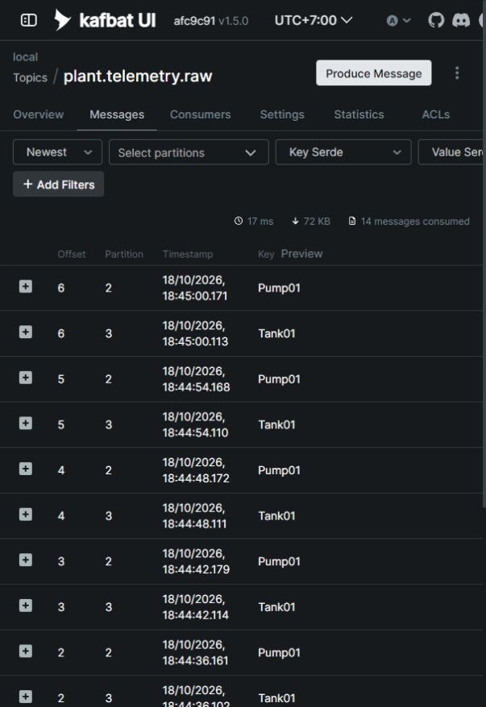

# M3 group 3 review: batching and Kafka publishing

Change: `add-end-to-end-slice`, tasks 3.1–3.4.
Branch: `m3-add-end-to-end-slice`.
Status: implementation and agent verification complete; reviewer approval pending.

## Task 3.1: per-asset batching

`AssetBatcher` preserves arrival order within each asset, flushes at 500 samples
or 5 seconds from the first sample, and flushes every open batch when its input
channel completes. A one-second `PeriodicTimer` uses the injected `TimeProvider`;
size flushes happen immediately. Each flush gets a new UUID v7 and UTC creation
time, while sample timestamps and raw status codes are preserved.

Cancellation aborts the pipeline; normal shutdown completes its input and drains
the output. A bounded output waits for the publisher, and bounded read turns let
the age timer run even when samples keep arriving.

`Microsoft.Extensions.TimeProvider.Testing` 10.11.0 is centrally versioned and used
only by Bridge unit tests. Source: [NuGet](https://www.nuget.org/packages/Microsoft.Extensions.TimeProvider.Testing/10.11.0).

Verification on 2026-10-18: all 50 Bridge unit tests passed, including six batching
cases for mixed assets, size, age, quiet input, shutdown and output backpressure.
Group 2 reviewer acceptance is recorded with this task.

## Task 3.2: topic initialization

`TopicInitializer` creates `plant.telemetry.raw` with six partitions, replication
factor one for the local broker, and `retention.ms=604800000`. It treats only
`TopicAlreadyExists` as success and preserves existing topic settings; other
admin failures fail startup. Kafka bootstrap servers default to `localhost:29092`.

Verification on 2026-10-18: both `KafkaTopicTests` passed against Testcontainers
Apache Kafka 4.3.1 with broker auto-create disabled. They check first creation,
repeated startup and preservation of an existing two-partition topic with custom
retention. The targeted command is:

```powershell
dotnet test --project tests/Telemetrix.Integration.Tests/Telemetrix.Integration.Tests.csproj -c Release -- --filter-class Telemetrix.Integration.Tests.KafkaTopicTests
```

## Task 3.3: publishing and host lifecycle

`KafkaBatchPublisher` awaits delivery of each shared UTF-8 JSON batch, keyed by
asset id, with `acks=all` and idempotence enabled. Delivery logs include batch id,
asset, sample count, partition and offset. Delivery timeout is ten seconds;
persistent Kafka outages and disk buffering remain M5 work.

The host initializes the topic before starting ingestion. Its pipeline uses
bounded channels of 1,024 samples and 64 batches. Normal shutdown cancels the
source, completes its channel, flushes open batches, and awaits publishing. A
failing stage cancels and awaits its peers; the host shutdown deadline can abort
a blocked drain. `Batching:MaxSamples`, `Batching:MaxAge` and
`Kafka:BootstrapServers` validate at startup and support standard environment
variable overrides.

Verification on 2026-10-18: Release build passed with zero warnings/errors; all 55
Bridge tests passed. `KafkaPublishingTests` passed against Testcontainers Kafka:
the real host delivered ten Pump01 batches and one Tank01 batch, with correct
keys, stable partitions, arrival order, JSON envelope and unique UUID v7 batch
ids, then drained on shutdown. Worker tests also cover a partial batch on shutdown
and publisher failure stopping its source. Targeted command:

```powershell
dotnet test --project tests/Telemetrix.Integration.Tests/Telemetrix.Integration.Tests.csproj -c Release -- --filter-class Telemetrix.Integration.Tests.KafkaPublishingTests
```

## Task 3.4: live OPC PLC verification

On 2026-10-18, the development Bridge ran against `opc.tcp://localhost:50000`
and Kafka at `localhost:29092`. It created the raw topic and monitored all seven
configured tags. Kafka UI showed six partitions, new JSON batches for both assets,
stable keys/partitions and increasing offsets. The temporary verification process
was stopped afterwards.

Observed Kafka UI timestamps in Asia/Jakarta (UTC+7):

| Asset key | Partition | Offset 5 | Offset 6 | Interval |
| --- | --- | --- | --- | --- |
| Pump01 | 2 | 18:44:54.168 | 18:45:00.171 | 6.003 s |
| Tank01 | 3 | 18:44:54.110 | 18:45:00.113 | 6.003 s |

The default five-second age is measured from the first arriving sample in each
open batch. The one-second age timer and the next sample's arrival can make
successive batch deliveries about five to six seconds apart. OPC PLC's tag
notification rates vary, so the two assets have different sample counts.
Payload inspection also confirmed numeric Running values, UTC `Z` timestamps,
and null values carrying their original Bad status codes.



## Commits and diff review

Read the commits after group 2 in task order:

```powershell
git log --oneline --reverse af458b9..HEAD
git diff af458b9..HEAD -- src/Telemetrix.Edge.Bridge/Batching tests/Telemetrix.Edge.Bridge.Tests/AssetBatcherTests.cs Directory.Packages.props
git diff af458b9..HEAD -- src/Telemetrix.Edge.Bridge/Publishing tests/Telemetrix.Integration.Tests/KafkaTopicTests.cs
git diff af458b9..HEAD -- src/Telemetrix.Edge.Bridge/Program.cs src/Telemetrix.Edge.Bridge/BridgeServiceCollectionExtensions.cs src/Telemetrix.Edge.Bridge/OpcUaIngestionWorker.cs src/Telemetrix.Edge.Bridge/appsettings.json tests/Telemetrix.Edge.Bridge.Tests tests/Telemetrix.Integration.Tests/KafkaPublishingTests.cs
```

- `d0c4659` — batch samples per asset by size and age (task 3.1).
- `4f8a0e5` — initialize the raw telemetry topic (task 3.2).
- `395f816` — publish keyed batches through the ingestion pipeline (task 3.3).
- `docs(bridge): record live kafka publishing verification` — live check and this review checkpoint (task 3.4).

Check first-sample age tracking, separate batches and arrival order for each
asset, completion-driven draining, peer cancellation on failure, shared JSON,
and the producer's reliability settings. The host now logs delivered batches
instead of individual samples.

## Manual verification

Run from the repository root. Docker must be running for integration and live
checks.

1. Build and run the tests:

   ```powershell
   dotnet build -c Release
   dotnet test --project tests/Telemetrix.Edge.Bridge.Tests/Telemetrix.Edge.Bridge.Tests.csproj --no-build -c Release
   dotnet test --no-build -c Release
   npx -y @fission-ai/openspec@1.14.3 validate --all --strict
   npx -y @fission-ai/openspec@1.14.3 list
   ```

   Expected: zero build warnings/errors; 55 Bridge tests and 60 tests overall
   pass; all nine OpenSpec items validate; M3 shows 7/14 tasks complete.

2. Confirm the local stack is running, or start it with the existing `deploy/.env`:

   ```powershell
   docker compose -f deploy/docker-compose.yml ps
   docker compose -f deploy/docker-compose.yml up -d
   ```

   Expected: OPC PLC, Kafka and Kafka UI are running; Kafka is healthy.

3. Start the development Bridge:

   ```powershell
   dotnet run --project src/Telemetrix.Edge.Bridge --no-build -c Release
   ```

   Expected: topic creation or an existing-topic log, seven monitored tags, then
   `Published batch` logs for Pump01 and Tank01 with batch id, count, partition
   and offset. Default host bootstrap servers are `localhost:29092`. To use a
   different broker, set `Kafka__BootstrapServers` before starting the Bridge.

4. Open [Kafka UI messages](http://localhost:8080/ui/clusters/local/all-topics/plant.telemetry.raw/messages).
   Select Newest and click Refresh after 15–20 seconds. Verify several batches
   for each asset: keys match `assetId`, each key stays in one partition, offsets
   increase, and new batches arrive around every five to six seconds. Expand a
   batch to check `schemaVersion=1`, a unique batch id, `source=opcua`, the local
   endpoint, identity, UTC timestamps, numeric/null values and raw status codes.
   Partition numbers may differ on another broker; stability per key is the check.

5. Check [topic overview](http://localhost:8080/ui/clusters/local/all-topics/plant.telemetry.raw)
   and [settings](http://localhost:8080/ui/clusters/local/all-topics/plant.telemetry.raw/settings):
   a newly created topic has six partitions, replication factor one and
   `retention.ms=604800000`. Existing topic settings are preserved deliberately.

6. Stop the Bridge with Ctrl+C. Expected: shutdown completes and any final open
   batches are published. Start it again and verify that existing topic settings
   are preserved and batch ids remain unique. Simulator values can exceed the
   domain's valid ranges; Quality mapping and range checking belong to group 4.

Database writes begin in group 5, and Grafana dashboards belong to M8; SQL and
dashboard acceptance checks are included with those stages.

## Agent verification and next checkpoint

Release build passed with zero warnings/errors; all 60 regression tests passed
with no failures or skips, including 55 Bridge unit tests, two OPC UA recovery
cases, two Kafka topic cases and the real-host Kafka publishing case. Strict
OpenSpec validation passed all nine items. The live OPC PLC → Kafka UI check is
recorded above. All tasks in group 3 are complete; group 4 (Transformer pipeline)
awaits reviewer approval under AGENTS.md's task-group checkpoint.
